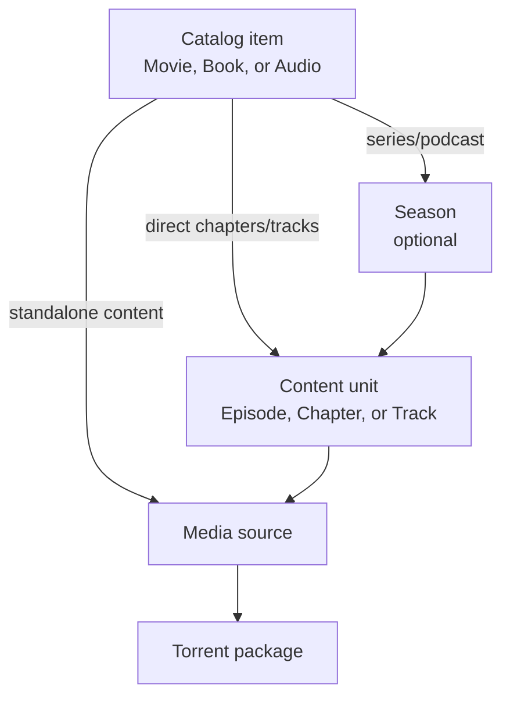

# Universal Media Distribution - Project Plan

Last updated: 2026-07-24

## 1. Product definition

Universal Media Distribution is a non-commercial catalog and media client for legally distributable indie, public-domain, Creative Commons, or otherwise authorized content.

The application provides three top-level content types:

- `Movie`: standalone movies, series, anime, documentaries, and other video.
- `Book`: books, novels, manga, comics, and similar reading content.
- `Audio`: music, audiobooks, podcasts, radio drama, and similar audio.

The application is local-first: catalog data, torrent descriptors, library
state, playback progress, and downloads work without an account or application
server. An optional NativeAOT server supplies signed desktop releases, an
opt-in online catalog, per-user device backup/sync, and revocable shared-list
catalogs. Trackers and peers remain external infrastructure required by the
BitTorrent protocols.

## 2. Fixed architecture decisions

### MVP UI and platforms

- Use Avalonia for the shared UI.
- Use native Avalonia targets for Windows, Linux, macOS, Android, and iOS.
- Do not use Blazor or a Blazor WebView.
- Browser/WebAssembly, PWA packaging, and WebTorrent
  are post-MVP. Their existing prototype code is retained for later work but is
  excluded from the default solution, release command, and MVP acceptance
  criteria.

### Torrent engines

- Native clients use [MonoTorrent](https://github.com/alanmcgovern/monotorrent).
- Shared application code depends on `ITorrentEngine`, not directly on
  MonoTorrent.
- Platform-specific capabilities remain explicit so a post-MVP engine can be
  added without changing the domain model.

### Post-MVP transport background

The retained browser prototype uses WebTorrent through JavaScript interop. It
is not an MVP build or release target.

| Capability | Native MVP / MonoTorrent | Post-MVP browser / WebTorrent |
|---|---|---|
| Peer transport | TCP/UDP BitTorrent | WebRTC data channels |
| Peer-wire encryption | MSE/PE policy | WebRTC DTLS |
| Tracker transport | HTTPS; UDP only when allowed | WSS |
| Private torrents | Supported | Supported with private mode |
| DHT/PEX/LSD control | Supported | Supported |
| Direct native-to-browser peer connection | No | No |

A hybrid seeder is required when the same release must be available to both native and browser clients. It joins the native BitTorrent swarm and the WebTorrent/WebRTC swarm while serving identical files.

## 3. Native MVP solution structure

```text
src/
  UniversalMediaDistribution.Domain/
  UniversalMediaDistribution.Application/
  UniversalMediaDistribution.Catalog/
  UniversalMediaDistribution.Reading.Abstractions/
  UniversalMediaDistribution.Reading.Pdfium/
  UniversalMediaDistribution.Torrenting.Abstractions/
  UniversalMediaDistribution.Torrenting.MonoTorrent/
  UniversalMediaDistribution.UI/
  UniversalMediaDistribution.Desktop/
  UniversalMediaDistribution.Android/
  UniversalMediaDistribution.iOS/
tests/
  UniversalMediaDistribution.Domain.Tests/
  UniversalMediaDistribution.Catalog.Tests/
  UniversalMediaDistribution.Torrenting.Tests/
  UniversalMediaDistribution.UI.Tests/
```

Responsibilities:

- `Domain`: catalog entities, value objects, validation rules, and engine-neutral enums.
- `Application`: browsing, searching, playback, reading, downloads, library, and progress use cases.
- `Catalog`: local database, migrations, repositories, catalog import, and catalog validation.
- `Reading.Abstractions`: renderer-neutral packaged-document contracts shared
  by native hosts.
- `Reading.Pdfium`: bounded native PDF parsing and lazy raster page rendering.
- `Torrenting.Abstractions`: shared torrent contracts and capability descriptions.
- `Torrenting.MonoTorrent`: native engine implementation.
- `UI`: shared Avalonia views, view models, navigation, and responsive styling.
- Platform projects: startup, dependency registration, secure storage, filesystem access, media integration, and packaging.

## 4. Catalog hierarchy



Metadata such as description, genre, creators, and content rating belongs to the top-level catalog item. Seasons and content units inherit it.

A content unit deliberately has only the information needed to identify, order, display, and open it. In the UI, the same entity is called:

- `Episode` for movies/series/anime.
- `Chapter` for books/manga/comics.
- `Track`, `Audio chapter`, or `Episode` for audio, depending on subtype.

Standalone content can attach a media source directly to the catalog item without creating a fake chapter.

## 5. Catalog database

### Database conventions

- Use stable `TEXT` identifiers containing UUIDs or ULIDs. Catalog updates must never replace an existing entity's identifier.
- Generate a new unique identifier only when an imported logical record does not already exist.
- Store timestamps as UTC ISO-8601 values.
- Use normalized tables for alternative names, genres, categories, credits, torrents, and trackers.
- Store thumbnail references, not large image blobs, in primary catalog rows.
- Define foreign keys and uniqueness constraints in the database and repeat important validation in the domain layer.
- Keep catalog data separate from user library, playback, and download state so catalog replacement cannot erase user state.
- Keep a derived `name_key` for deterministic catalog-only JSON imports. It is produced by trimming, collapsing repeated whitespace, applying Unicode compatibility normalization, and invariant case folding; matching is exact after that normalization and never fuzzy.

### 5.1 `media_types`

Defines the three stable top-level types.

| Column | Type | Rules / purpose |
|---|---|---|
| `id` | TEXT | Primary key: `movie`, `book`, or `audio` |
| `display_name` | TEXT | Localizable display label |
| `sort_order` | INTEGER | Navigation order |

These values are effectively an enum, but keeping a lookup table makes imported catalogs easier to validate.

### 5.2 `media_subtypes`

Defines presentation and hierarchy behavior without hard-coding every subtype into the UI.

| Column | Type | Rules / purpose |
|---|---|---|
| `id` | TEXT | Primary key, for example `movie.anime_series` |
| `media_type_id` | TEXT | FK to `media_types` |
| `display_name` | TEXT | Localizable label |
| `hierarchy_mode` | TEXT | `single`, `seasons`, `chapters`, or `tracks` |
| `default_unit_kind` | TEXT | `episode`, `chapter`, `track`, or null |
| `is_enabled` | INTEGER | Boolean |
| `sort_order` | INTEGER | Subtype display order |

Initial subtype set:

| Top-level type | Initial subtypes |
|---|---|
| Movie | Movie, Series, Anime Movie, Anime Series, Documentary, Short |
| Book | Book, Novel, Manga, Comic, Light Novel, Web Novel |
| Audio | Music Album, Single, Audiobook, Podcast, Radio Drama |

Subtype rules are data-driven. For example, `movie.series` uses seasons and episodes, while `book.manga` uses chapters directly. More subtypes can be added without a database migration.

### 5.3 `catalog_items`

Stores the normal descriptive information for a title. A series or manga run is one catalog item, not one item per episode or chapter.

| Column | Type | Rules / purpose |
|---|---|---|
| `id` | TEXT | Primary key |
| `media_type_id` | TEXT | FK to `media_types` |
| `subtype_id` | TEXT | FK to `media_subtypes`; must belong to the selected media type |
| `name` | TEXT | Required public title |
| `name_key` | TEXT | Required normalized import/matching key derived from `name` |
| `original_name` | TEXT | Optional original-language title |
| `sort_name` | TEXT | Optional normalized sorting title |
| `description` | TEXT | Main synopsis or description |
| `release_date` | TEXT | Optional full or partial release date |
| `end_date` | TEXT | Optional, mainly for completed series |
| `publication_status` | TEXT | `announced`, `ongoing`, `completed`, `cancelled`, or `unknown` |
| `original_language` | TEXT | BCP-47 language tag when known |
| `country_code` | TEXT | Optional ISO country code |
| `content_rating` | TEXT | Optional age/content rating |
| `runtime_seconds` | INTEGER | Optional for standalone movie/audio content |
| `page_count` | INTEGER | Optional for a single book |
| `thumbnail_ref` | TEXT | Poster, cover, or square thumbnail reference |
| `backdrop_ref` | TEXT | Optional wide hero artwork reference |
| `created_at` | TEXT | Catalog record creation time |
| `updated_at` | TEXT | Last catalog update time |

`catalog_items` is the only place that requires name, genre/category links, description, general credits, and content rating. Chapters do not duplicate these values.

Unique constraint: (`media_type_id`, `name_key`). This implements the requested name-based catalog import behavior while allowing a movie and a book to share the same display name.

### 5.4 `catalog_alternative_names`

Optional alternative, translated, or romanized titles used by search and display.

| Column | Type | Rules / purpose |
|---|---|---|
| `id` | TEXT | Primary key |
| `catalog_item_id` | TEXT | FK to `catalog_items` |
| `name` | TEXT | Alternative or translated title |
| `name_key` | TEXT | Normalized matching key derived from `name` |
| `language` | TEXT | BCP-47 language tag, or `und` when unknown |
| `alias_type` | TEXT | `translation`, `romanized`, `short`, or `other` |

Unique constraint: (`catalog_item_id`, `name_key`, `language`, `alias_type`). A movie or book may therefore have multiple names, including the same localized name in distinct languages or forms.

### 5.5 `genres`

| Column | Type | Rules / purpose |
|---|---|---|
| `id` | TEXT | Primary key, stable slug such as `science-fiction` |
| `name` | TEXT | Display name |

### 5.6 `catalog_item_genres`

Many-to-many mapping because a title can have several genres.

| Column | Type | Rules / purpose |
|---|---|---|
| `catalog_item_id` | TEXT | FK to `catalog_items` |
| `genre_id` | TEXT | FK to `genres` |

Primary key: (`catalog_item_id`, `genre_id`). Content units inherit these genres.

### 5.7 `categories`

Categories are a second title taxonomy for shelves or catalog grouping, separate from descriptive genres. They currently apply to Movie and Book items.

| Column | Type | Rules / purpose |
|---|---|---|
| `id` | TEXT | Primary key |
| `name` | TEXT | Display name |
| `name_key` | TEXT | Unique normalized category key |

### 5.8 `catalog_item_categories`

Many-to-many mapping because a movie or book can belong to multiple categories.

| Column | Type | Rules / purpose |
|---|---|---|
| `catalog_item_id` | TEXT | FK to `catalog_items` |
| `category_id` | TEXT | FK to `categories` |

Primary key: (`catalog_item_id`, `category_id`). Content units inherit their parent item's categories.

### 5.9 `contributors`

Represents either a person or an organization.

| Column | Type | Rules / purpose |
|---|---|---|
| `id` | TEXT | Primary key |
| `name` | TEXT | Required display name |
| `kind` | TEXT | `person` or `organization` |
| `url` | TEXT | Optional absolute HTTP/HTTPS contributor or provider page |
| `thumbnail_ref` | TEXT | Optional portrait/logo |

### 5.10 `catalog_item_credits`

| Column | Type | Rules / purpose |
|---|---|---|
| `catalog_item_id` | TEXT | FK to `catalog_items` |
| `contributor_id` | TEXT | FK to `contributors` |
| `role` | TEXT | Author, artist, director, studio, actor, narrator, composer, etc. |
| `character_name` | TEXT | Optional performance role |
| `sort_order` | INTEGER | Credit display order |

Credits belong to the parent item for the initial version. Unit-specific credits can be added later only if a real catalog source requires them.

### 5.11 `seasons`

Provides grouping for series, anime series, and optionally seasonal podcasts.

| Column | Type | Rules / purpose |
|---|---|---|
| `id` | TEXT | Primary key |
| `catalog_item_id` | TEXT | FK to `catalog_items` |
| `season_number` | INTEGER | `0` can represent specials |
| `display_name` | TEXT | Optional; generated from the number when absent |
| `thumbnail_ref` | TEXT | Optional season thumbnail/poster |
| `release_date` | TEXT | Optional |
| `sort_order` | INTEGER | Required ordering value |

Unique constraint: (`catalog_item_id`, `season_number`). Seasons do not have their own genres, full descriptions, or general credits.

### 5.12 `content_units`

Represents an episode, book/manga chapter, track, audiobook chapter, or podcast episode.

| Column | Type | Rules / purpose |
|---|---|---|
| `id` | TEXT | Primary key |
| `catalog_item_id` | TEXT | FK to `catalog_items` |
| `season_id` | TEXT | Optional FK to `seasons` |
| `unit_kind` | TEXT | `episode`, `chapter`, `track`, or `audio_chapter` |
| `display_number` | TEXT | Human label such as `12`, `12.5`, `OVA 1`, or `A3` |
| `name` | TEXT | Optional short title; not required |
| `sort_order` | INTEGER | Required stable order within its parent/season |
| `thumbnail_ref` | TEXT | Optional episode/chapter/track thumbnail |
| `duration_seconds` | INTEGER | Optional for video/audio |
| `page_count` | INTEGER | Optional for book/manga chapters |
| `release_date` | TEXT | Optional |
| `is_special` | INTEGER | Boolean |

The table intentionally does **not** contain description, genre, rating, country, or full credits. Those values are inherited from `catalog_items`.

Validation rules:

- `season_id`, when present, must refer to a season belonging to the same catalog item.
- `unit_kind` must be compatible with the item's subtype.
- (`season_id`, `sort_order`) must be unique for seasonal items.
- (`catalog_item_id`, `sort_order`) must be unique for direct chapters/tracks without a season.

### 5.13 `distribution_rights`

Records why the content may be distributed. This is important for a catalog focused on indie/free/legal content.

| Column | Type | Rules / purpose |
|---|---|---|
| `id` | TEXT | Primary key |
| `catalog_item_id` | TEXT | FK to `catalog_items` |
| `source_name` | TEXT | Publisher, creator, archive, or catalog provider |
| `source_uri` | TEXT | Original source page |
| `license_name` | TEXT | For example a Creative Commons license or custom permission |
| `license_uri` | TEXT | Optional license link |
| `attribution` | TEXT | Required attribution text when applicable |
| `rights_note` | TEXT | Additional distribution restrictions or evidence |
| `verified_at` | TEXT | Last verification time |

## 6. Torrent and media-source tables

Separating torrent packages from catalog items is necessary because one torrent can contain a whole season, manga volume, album, subtitles, or bonus files.

### 6.1 `torrent_packages`

One row represents one torrent swarm/package.

| Column | Type | Rules / purpose |
|---|---|---|
| `id` | TEXT | Primary key |
| `display_name` | TEXT | Catalog-facing package label |
| `language` | TEXT | BCP-47 package language, or `und` when unknown |
| `magnet_uri` | TEXT | Optional magnet URI |
| `torrent_metadata` | BLOB | Optional complete `.torrent` data |
| `info_hash_v1` | TEXT | Optional BitTorrent v1 hash |
| `info_hash_v2` | TEXT | Optional BitTorrent v2 hash |
| `is_private` | INTEGER | Boolean private-torrent policy |
| `total_size` | INTEGER | Optional total bytes |
| `source_uri` | TEXT | Optional provenance page |
| `created_at` | TEXT | Creation/import time |
| `updated_at` | TEXT | Last catalog update time |

At least one of `magnet_uri` or `torrent_metadata` is required. Full `.torrent` metadata is preferred for private torrents because it carries the private flag and tracker tiers as part of the release metadata.

### 6.2 `tracker_endpoints`

Describes tracker routing without storing secrets.

| Column | Type | Rules / purpose |
|---|---|---|
| `id` | TEXT | Primary key |
| `name` | TEXT | Friendly tracker name |
| `endpoint_template` | TEXT | URL/template without an embedded shared secret |
| `transport` | TEXT | `https`, `wss`, or `udp` |
| `client_family` | TEXT | `native`, `browser`, or `both` |
| `requires_authentication` | INTEGER | Boolean |
| `credential_key` | TEXT | Optional lookup key for platform credential storage; never the credential itself |
| `is_enabled` | INTEGER | Boolean |

### 6.3 `torrent_package_trackers`

Allows ordered tracker tiers and different endpoints for native and browser clients.

| Column | Type | Rules / purpose |
|---|---|---|
| `torrent_package_id` | TEXT | FK to `torrent_packages` |
| `tracker_endpoint_id` | TEXT | FK to `tracker_endpoints` |
| `tier` | INTEGER | Tracker tier |
| `sort_order` | INTEGER | Order inside the tier |

Primary key: (`torrent_package_id`, `tracker_endpoint_id`).

### 6.4 `media_sources`

Maps a playable/readable catalog target to a file inside a torrent package. This supports season packs and multi-file torrents without repeating magnets on every chapter.

| Column | Type | Rules / purpose |
|---|---|---|
| `id` | TEXT | Primary key |
| `torrent_package_id` | TEXT | FK to `torrent_packages` |
| `catalog_item_id` | TEXT | Nullable FK for standalone content |
| `content_unit_id` | TEXT | Nullable FK for an episode/chapter/track |
| `asset_role` | TEXT | `primary`, `subtitle`, `supplement`, or `preview` |
| `source_layout` | TEXT | `single_file` or `image_sequence` |
| `file_index` | INTEGER | Optional torrent file index |
| `file_path` | TEXT | Expected file path, or containing directory/prefix for an image sequence |
| `mime_type` | TEXT | Optional MIME type |
| `container` | TEXT | MKV, MP4, EPUB, PDF, CBZ, `IMAGE_SEQUENCE`, MP3, FLAC, etc. |
| `video_quality` | TEXT | Optional: 720p, 1080p, 4K, etc. |
| `language` | TEXT | Optional BCP-47 language tag |
| `size_bytes` | INTEGER | Optional expected file size |
| `sort_order` | INTEGER | Source/variant preference order |

Exactly one of `catalog_item_id` and `content_unit_id` must be set. A database `CHECK` constraint should enforce this.

Examples:

- A standalone movie maps its catalog item directly to an MP4/MKV file.
- A series season torrent maps each episode unit to its corresponding file index.
- A single EPUB maps directly to a book item.
- A single JPG/JPEG, PNG, or WebP file maps directly to a one-page book or chapter.
- A manga chapter unit maps to a CBZ/PDF file.
- A manga chapter can map to an `IMAGE_SEQUENCE` directory containing ordered image files.
- An album torrent maps each track unit to an audio file.

For portable alternate audio, map each complete muxed language rendition as a
`primary` source on the same movie or episode target. Set `language` on every
rendition and use `sort_order` for the preferred order. Renditions should share
the same timeline so the player can retain its current position when switching.
External audio-only slave files are not part of the portable catalog contract.

### 6.5 Image-sequence reader contract

Books and manga may be delivered as multiple image files instead of PDF, EPUB, or CBZ. In this case, the `media_sources` row uses `source_layout = image_sequence`, `container = IMAGE_SEQUENCE`, and `file_path` identifies the directory or path prefix belonging to that book/chapter.

#### Filename and ordering rules

- Each readable image filename must end in `_<x>` immediately before its extension, where `x` is a non-negative integer position.
- Positions are zero-based and must start with `_0`.
- Example: `page_0.webp`, `page_1.webp`, `page_2.webp`.
- Extract the final numeric suffix with the equivalent of `_(\d+)$` from the filename without its extension.
- Sort by the parsed integer, never lexicographically. Therefore `_9` is followed by `_10`.
- Positions must be unique and contiguous from `0` through `N - 1`.
- Duplicate positions, a missing `_0`, or gaps make the image sequence invalid and must produce a clear catalog/source validation error.
- Non-image files and image files without a valid numeric suffix are not reader pages and are ignored unless explicitly mapped as another asset.
- Initial supported page formats should be JPEG, PNG, WebP, and AVIF when the target platform decoder supports them.

Examples:

```text
chapter-001/
  page_0.jpg
  page_1.jpg
  page_2.jpg
  ...
  page_9.jpg
  page_10.jpg
```

The ellipsis represents the files for positions `3` through `8`. The parser uses numeric order, so `_9` precedes `_10`; it must not use filesystem/string ordering, which could place `_10` before `_2`.

#### Reader display modes

The user can switch between two modes while keeping the same reading position:

- `paged`: show exactly one image as one page. Previous/next buttons, keyboard input, touch gestures, and page selection move by numeric image position.
- `continuous`: render all pages vertically from position `0` downward in numeric order. Images are stacked top-to-bottom and loaded lazily around the viewport.

Progress uses `playback_progress.position_kind = image` and stores the zero-based image position. In continuous mode, progress is the page with the greatest visible area or the first page crossing the reading anchor. Switching modes must reopen that same position rather than returning to the start.

Torrent piece/file priority should follow the reading order:

- In paged mode, prioritize the current image and prefetch the next small group of images.
- In continuous mode, prioritize visible images and a bounded window below the viewport.
- Do not create object URLs or decoded bitmaps for every page at once; release them when they are sufficiently far outside the active window.
- Native and browser readers must apply the same filename parser and ordering validation so a source behaves identically on every platform.

## 7. Local user-state tables

These tables are not part of the distributable catalog and must survive catalog upgrades.

### 7.1 `library_entries`

| Column | Purpose |
|---|---|
| `catalog_item_id` | Primary key/FK to the saved item |
| `is_favorite` | Favorite flag |
| `added_at` | Date added to library |
| `last_opened_at` | Recent-items ordering |
| `user_rating` | Optional private rating |

### 7.2 `playback_progress`

| Column | Purpose |
|---|---|
| `id` | Primary key |
| `catalog_item_id` | Nullable target for standalone content |
| `content_unit_id` | Nullable target for episode/chapter/track |
| `position` | Seconds, page, image index, or normalized progress depending on media |
| `position_kind` | `seconds`, `page`, `image`, or `fraction` |
| `is_completed` | Completion flag |
| `updated_at` | Last progress update |

Exactly one target must be set.

### 7.3 `download_jobs`

| Column | Purpose |
|---|---|
| `id` | Primary key |
| `torrent_package_id` | Torrent being downloaded |
| `state` | Queued, metadata, downloading, seeding, paused, complete, or failed |
| `selected_file_indexes` | Serialized selection or separate child rows |
| `download_location` | Native path or browser storage key |
| `bytes_downloaded` | Persisted progress snapshot |
| `error_code` | Last stable application error code |
| `created_at` / `updated_at` | Job timestamps |

Native and browser storage locations are platform-specific and must not leak into the domain model beyond an opaque location identifier.

### 7.4 `reader_preferences`

Stores the user's per-title image-reader choice. If an item has no row, the application-wide default is used.

| Column | Purpose |
|---|---|
| `catalog_item_id` | Primary key/FK to a book or manga item |
| `display_mode` | `paged` or `continuous` |
| `updated_at` | Last preference change |

### 7.5 `favorite_contributors`

Stores the user's favorite provider/contributor identities separately from the
distributable catalog.

| Column | Purpose |
|---|---|
| `contributor_key` | Primary key built from contributor kind and normalized name |
| `added_at` | Time the provider was favorited |

When no provider filter is active, catalog cards linked to one or more favorite
contributors are displayed first. Each favorite/non-favorite group is then
sorted by the title selected for the current UI locale.

### 7.6 `user_media_lists` and `user_media_list_items`

Stores user-created named lists separately from the distributable catalog. A
single list can mix movie, anime, book, manga, and audio catalog items.

| Table / column | Purpose |
|---|---|
| `user_media_lists.id` | Stable local list ID |
| `user_media_lists.name` | User-visible normalized name |
| `user_media_lists.name_key` | Unique case/diacritic-insensitive name key |
| `created_at` / `updated_at` | List timestamps |
| `user_media_list_items.list_id` | FK to the containing list |
| `user_media_list_items.catalog_item_id` | FK to a saved catalog item |
| `user_media_list_items.added_at` | Membership timestamp |

List membership is retained when a catalog item is refreshed or merged because
the existing local catalog ID is preserved. Deleting a catalog item or list
removes its membership rows through foreign-key cascades.

### 7.7 `schema_info`

Tracks catalog schema version, user-state schema version, catalog revision, and last successful import.

### 7.8 `catalog_import_history`

Records completed catalog-only JSON imports for diagnostics and duplicate-file detection. It is operational/user-local state and is not exported in catalog-only JSON.

| Column | Purpose |
|---|---|
| `id` | Primary key |
| `document_hash` | SHA-256 of the imported JSON bytes |
| `source_name` | Original filename or source label |
| `format_version` | Imported catalog JSON version |
| `created_count` | Number of newly generated records |
| `updated_count` | Number of matched records updated |
| `warning_count` | Non-fatal validation warnings |
| `imported_at` | Successful transaction time |

## 8. Artwork policy

- `catalog_items.thumbnail_ref` is the main movie poster, book/manga cover, or audio artwork.
- `catalog_items.backdrop_ref` is optional wide artwork for detail pages.
- `seasons.thumbnail_ref` is optional season artwork.
- `content_units.thumbnail_ref` is optional episode/chapter/track artwork.
- Chapters do not need descriptions or genres simply to support thumbnails.
- A reference can point to a bundled asset, local cached asset, or approved HTTPS source.
- Do not store large image data directly in frequently queried catalog rows.
- Add a separate `artwork_assets` table later only if multiple resolutions, hashes, and offline image variants are required.

## 9. Torrent abstraction

The shared interface should express operations and capabilities rather than library-specific objects.

```csharp
public interface ITorrentEngine
{
    TorrentEngineCapabilities Capabilities { get; }

    Task<TorrentSession> AddAsync(
        TorrentDescriptor descriptor,
        TorrentAddOptions options,
        CancellationToken cancellationToken);

    Task<IReadOnlyList<TorrentFile>> GetFilesAsync(
        TorrentSessionId sessionId,
        CancellationToken cancellationToken);

    Task<MediaReadHandle> OpenReadAsync(
        TorrentSessionId sessionId,
        TorrentFileSelector file,
        CancellationToken cancellationToken);

    Task PauseAsync(TorrentSessionId sessionId, CancellationToken cancellationToken);
    Task ResumeAsync(TorrentSessionId sessionId, CancellationToken cancellationToken);
    Task RemoveAsync(TorrentSessionId sessionId, bool deleteData, CancellationToken cancellationToken);
}
```

The final contract may separate streaming, download, and session-control interfaces, but it must include:

- Metadata discovery.
- File listing and selection.
- Priority/sequential download hints.
- Stream/read-handle creation.
- Progress, peer, speed, and state notifications.
- Pause, resume, remove, and optional seeding.
- Private-mode and tracker configuration.
- A capability object so UI behavior is deterministic.

## 10. Private trackers and encryption

### Private swarm policy

When `torrent_packages.is_private` is true:

- Disable DHT, PEX, and local peer discovery.
- Do not append public trackers from defaults or user settings.
- Reject unexpected tracker URLs unless explicitly approved.
- Native clients use the authorized HTTPS private tracker and the configured MonoTorrent MSE policy.
- Browser clients use an authorized WebTorrent-compatible WSS tracker; a conventional HTTP/UDP tracker is not sufficient for browser WebRTC peers.
- Tracker credentials are obtained through `ITrackerCredentialProvider` and are never embedded in catalog records, logs, or the WASM bundle.

### Credential storage

- Native: use platform secure storage/keychain facilities.
- Browser: use user-specific, revocable tokens; no browser storage can make a secret inaccessible to the user who runs the application.
- Prefer short-lived credentials if an external identity service is introduced later.
- A shared permanent passkey must never be shipped in the application or public catalog.

### Meaning of encryption

- MonoTorrent MSE/PE, WebRTC DTLS, HTTPS, and WSS encrypt or obfuscate traffic in transit.
- These mechanisms do not keep media secret from an authorized peer after download.
- Actual content confidentiality would require pre-encrypted media, chunk-aware authenticated decryption, and separate key distribution. This is deferred and would change the current no-backend design.

## 11. Local storage strategy

### Native

- SQLite for catalog and user state.
- Normal filesystem storage for torrent data and cached artwork.
- Platform secure storage for tracker credentials.

Browser persistence, including IndexedDB or SQLite WASM/OPFS, is post-MVP.

## 12. Import, export, catalog distribution, and updates

The application supports two intentionally different transfer formats.

| Format | Purpose | IDs | User data |
|---|---|---|---|
| Full database backup | Backup, restore, or move the complete local application database | Preserved | Included |
| Catalog-only JSON | Share or merge distributable catalog metadata | Omitted | Excluded |

### 12.1 Full database backup

The UI exposes **Export full database** and **Restore full database** operations.

- The backup contains all logical database tables, including catalog records, stable IDs, library entries, named lists and membership, playback/reading progress, reader preferences, download job metadata, schema information, and import history.
- Relationships and IDs are preserved exactly so a restore produces the same logical database.
- The export is a consistent snapshot; it must not copy a live native SQLite file while a write is in progress.
- Use a versioned, cross-platform application container such as `.umdbackup` with a manifest, database snapshot, and checksums. The logical format must be readable regardless of whether the source platform uses SQLite, SQLite WASM, or IndexedDB internally.
- Tracker credentials remain outside the database and are not included.
- Downloaded media, active torrent pieces, temporary files, and caches are not included. Their database records may be restored as unavailable jobs and reconciled with local storage afterward.
- Before restore, validate the application identifier, format version, schema version, checksums, and all relational constraints.
- A restore replaces the current logical database. Create a recoverable safety backup first, then restore and migrate inside an atomic operation.
- If validation or migration fails, keep the existing database unchanged.
- Full database import is the operation to use when IDs and user state must be retained. It is not the catalog merge format.

Because a full backup contains viewing history and library data, the UI must describe it as private user data. Password-encrypted backup containers can be added independently from torrent transport encryption.

### 12.2 Catalog-only JSON

The UI exposes **Export catalog JSON** and **Import catalog JSON** operations.

The catalog JSON contains only non-user, distributable catalog information:

- Media type and subtype values.
- Catalog item metadata and localized alternative names.
- Genres, categories, and credits/contributors.
- Seasons and content units.
- Distribution-rights/provenance records.
- Torrent descriptors, non-secret tracker endpoint definitions, and media-source/file mappings.

It excludes:

- Every generated database `id` and foreign-key ID.
- Derived `name_key` values; import recalculates them.
- Library, favorite, named-list, progress, reader-preference, and download-job tables.
- Schema/import history that only describes the local installation.
- Tracker passkeys, tokens, credential keys, filesystem paths, caches, and downloaded content.

Protocol identities such as BitTorrent v1/v2 info hashes are content identifiers, not database IDs, so they remain in the JSON when available. Static values such as `movie`, `book`, `audio`, `manga`, and `episode` also remain as semantic values.

The JSON should be nested around each catalog item so relationships do not require foreign-key IDs. Torrent packages repeated by multiple sources are deduplicated during import by their protocol identity.

Example without database IDs:

```json
{
  "format": "universal-media-distribution.catalog",
  "version": 1,
  "items": [
    {
      "mediaType": "book",
      "subtype": "manga",
      "name": "Example Manga",
      "description": "Example catalog description",
      "thumbnailRef": "artwork/example-manga.webp",
      "genres": ["Adventure"],
      "categories": ["Manga", "Independent"],
      "alternativeNames": [
        {
          "name": "Manga de ejemplo",
          "language": "es",
          "aliasType": "translation"
        }
      ],
      "contributors": [
        {
          "name": "Example Creator",
          "kind": "person",
          "url": "https://example.org/example-creator",
          "credits": [
            {
              "role": "Author",
              "sortOrder": 0
            },
            {
              "role": "Artist",
              "sortOrder": 1
            }
          ]
        }
      ],
      "units": [
        {
          "kind": "chapter",
          "displayNumber": "1",
          "thumbnailRef": "artwork/example-manga-1.webp",
          "sources": [
            {
              "assetRole": "primary",
              "sourceLayout": "image_sequence",
              "container": "IMAGE_SEQUENCE",
              "filePath": "chapter-001/",
              "torrent": {
                "magnetUri": "magnet:?xt=urn:btih:EXAMPLE",
                "language": "en",
                "isPrivate": false,
                "trackers": [
                  {
                    "transport": "wss",
                    "clientFamily": "browser",
                    "endpoint": "wss://tracker.example/announce"
                  }
                ]
              }
            }
          ]
        }
      ]
    }
  ]
}
```

### 12.3 Name equality and natural keys

The requested update rule for a top-level item is:

```text
existing.media_type == imported.media_type
and existing.name_key == NormalizeName(imported.name)
```

This is exact normalized equality, not fuzzy matching. Matching is scoped by media type so a book and a movie named `Dune`, for example, do not overwrite each other.

`NormalizeName` must be shared by export, import, database validation, and tests. It performs:

1. Leading/trailing whitespace removal.
2. Repeated internal whitespace collapse.
3. Unicode compatibility normalization.
4. Invariant case folding.

Other records use deterministic natural keys because their IDs are also absent from catalog JSON:

| Record | Import natural key |
|---|---|
| Media subtype | Media type + normalized subtype name/code |
| Catalog item | Media type + normalized item name |
| Alternative name | Parent item + normalized name + language + name type |
| Genre | Normalized genre name |
| Category | Normalized category name |
| Contributor | Contributor kind + normalized contributor name |
| Credit | Parent item + contributor natural key + role + character name |
| Season | Parent item + season number |
| Content unit | Parent item + optional season number + unit kind + display number |
| Torrent package | Info hash v2, otherwise info hash v1, otherwise normalized magnet URI |
| Tracker endpoint | Transport + client family + normalized endpoint template |
| Media source | Target natural key + torrent natural key + asset role + file path |
| Distribution right | Parent item + normalized source URI + license name |

Two records with the same natural key inside one import document are an error. If the local database somehow contains multiple matches, import must stop and report the ambiguity rather than choosing one.

Name-based identity has an intentional initial limitation: two titles of the same media type cannot have the same normalized name. Supporting same-name remakes or editions later will require an additional non-database identity field such as a catalog key, release year, or edition key.

### 12.4 Catalog JSON import algorithm

1. Read the document with file-size and nesting limits.
2. Validate the format/version and JSON structure.
3. Normalize names and construct every natural key.
4. Validate media type/subtype compatibility, hierarchy, image-sequence numbering, rights metadata, torrent mappings, private-mode rules, and duplicate natural keys.
5. Produce a dry-run preview showing records to create, update, or skip, plus warnings. No database mutation happens during preview.
6. For each natural key, reuse the existing database row and its ID when a match exists.
7. Generate a new UUID/ULID for every new row, including new nested rows, then resolve all relationships using those generated or reused IDs.
8. Update matched rows with fields present in the JSON. An explicit JSON `null` clears a nullable value; an omitted property leaves the current value unchanged.
9. Merge/upsert child collections by their natural keys. The initial importer is non-destructive: local items or children omitted from the JSON are not deleted.
10. Commit all changes and `catalog_import_history` in one transaction. Any error rolls back the complete import.
11. Return a report with created, updated, unchanged, and warning counts and the affected item names.

For the top-level behavior requested by this plan:

- Importing a new name generates a unique ID and inserts it.
- Importing the same normalized name under the same media type updates the existing row and preserves its current ID and user relationships.
- Importing the same name under a different media type creates a separate item.
- Importing a changed/renamed title currently creates a new item because the old name no longer matches. Rename support is deferred until a stable external catalog key is introduced.

### 12.5 Catalog JSON export rules

- Export either all catalog items or a user-selected subset.
- Emit no property named `id` and no database foreign-key values.
- Express relationships through nesting, semantic type values, names, season numbers, unit display numbers, info hashes, tracker endpoints, and file paths.
- Emit deterministic property and collection ordering so version-control diffs remain readable.
- Include a format version and optional catalog revision, creation time, source label, and detached signature metadata.
- Never export tracker credentials or user-local paths.
- Validate the generated document against the same schema used by import before offering the file.
- A JSON export followed by import into an empty database must recreate the same non-user catalog content with newly generated IDs.

### 12.6 Distribution without an application backend

- Ship a small initial catalog with the application.
- Import catalog JSON from a local file or approved static URL.
- Use transactional, idempotent imports and version the JSON format, database schema, and catalog revision separately.
- Prefer signed catalog JSON/packages so magnets, tracker endpoints, and metadata can be authenticated before import.
- Never delete user progress merely because an item is absent from an imported document or newer catalog revision.
- If a catalog item is intentionally withdrawn, represent that with an explicit catalog status/tombstone in a future format rather than treating omission as deletion.

### 12.7 Incoming magnets and torrent-local `info.json`

The MVP can receive a magnet from its input field or a native launch argument.
Automatic opening is opt-in and disabled by default; otherwise an incoming link
waits for explicit confirmation. The preference is stored in native SQLite.

Magnet intake applies these rules before an engine is called:

- Require a valid BitTorrent v1 `btih` or v2 `btmh` exact topic and reject conflicting identities, oversized links, fragments, and unbounded tracker lists.
- Deduplicate open sessions by normalized swarm identity.
- Treat externally received magnets as public unless they declare private mode
  or the user enables the saved force-private option. Private native sessions
  require a compatible HTTPS tracker. UDP is never accepted for private intake.
- Pass only tracker transports supported by the active engine. Catalog identity magnets omit tracker URLs so untrusted or credential-bearing endpoints are not persisted.
- Bound torrent metadata lookup to 30 seconds. A timeout or invalid local manifest reports a warning while leaving the torrent session open.

When enabled, the application looks for one file whose basename is `info.json` (case-insensitive) after torrent metadata arrives. It must be at most 4 MiB and use the same versioned, ID-free catalog JSON contract described above, but every media source must repeat an identity from the active magnet and map to a file in that torrent. Artwork references must also resolve to unique files in that torrent. Absolute paths, traversal segments, duplicate paths/indexes, a second `info.json`, foreign swarm identities, mapping `info.json` as media, and invalid image sequences reject the manifest atomically.

Before import, the application replaces each declared source identity with the normalized active identity, removes embedded `.torrent` bytes and manifest-supplied trackers, and applies the active private-mode policy. Existing items are then updated by normalized media type/name and new items receive new local IDs, exactly like a normal catalog JSON import. See `docs/TORRENT_INFO_MANIFEST.md` and `docs/examples/torrent-info.json` for the publisher contract.

## 13. Delivery phases

### Phase 1 — Foundation

- Replace the current Blazor starter with the Avalonia multi-platform structure.
- Create domain entities and catalog enums/value objects.
- Define `ITorrentEngine` and its capability model.
- Add dependency-injection composition for native hosts.
- Establish automated desktop and mobile builds.

### Phase 2 — Catalog MVP

- Implement schema and migrations.
- Add repositories, search, filtering, and subtype validation.
- Implement full database backup/restore with ID preservation and rollback safety.
- Implement catalog-only JSON export/import without database IDs, including dry-run previews and transactional name-based upserts.
- Add round-trip, duplicate-name, cross-media-name, invalid-document, and rollback tests for both transfer formats.
- Seed representative items: standalone movie, series with seasons, anime, single book, manga chapters, and an audio album.
- Build home, browse, details, season/chapter listing, and search screens.
- Implement thumbnails at item, season, and content-unit levels.

### Phase 3 — Native torrent engine

Status: completed and verified on 2026-07-22.

- Integrate MonoTorrent.
- Add magnet and `.torrent` metadata handling.
- Implement file selection, sequential priority, streaming reads, downloads, pause/resume, and seeding.
- Add HTTPS private tracker support and configurable MSE policy.
- Persist fast-resume/download state.

### Post-MVP prototype — Browser torrent engine

Status: prototype retained outside the native MVP solution and release.

- Bundle WebTorrent as an application JavaScript module.
- Implement typed JS interop for client/session lifecycle, events, file selection, streaming, download, and cleanup.
- Add WebRTC/WSS private-mode configuration.
- Handle browser storage quota, tab lifecycle, and object URL/stream cleanup.

### Phase 5 — Media experiences

Status: in progress. Catalog details, native desktop playback, progress,
artwork, direct and sequenced image reading, bounded CBZ/PDF reading, a safe
mixed-content EPUB reader, and portable alternate-audio rendition switching
are implemented. Full EPUB CSS/fixed-layout behavior remains open.

- Video/audio playback with seeking and progress persistence.
- Implement the required image-sequence reader with paged and continuous top-to-bottom modes.
- Apply zero-based numeric filename ordering and source validation identically
  on native clients.
- Add reader support for a small approved set of packaged formats such as EPUB, PDF, and CBZ.
- Resume playback/reading across application restarts on the same device.
- Subtitle and multi-audio source selection where catalog mappings provide them.

### Phase 6 — Privacy and interoperability

Status: completed and verified on 2026-07-23. Private torrents and authenticated
trackers remain optional; public torrent intake is the default.

- Enforce private torrent restrictions in the domain and native adapter.
- Implement tracker credential providers and log redaction.
- Validate approved HTTPS private-tracker routing for native releases.
- Add negative tests proving private sessions never use DHT, PEX, LSD, or public trackers.

### Phase 7 — Mobile, packaging, and hardening

Status: in progress. Android/iOS hosts, Android TV packaging/navigation,
shared lifecycle policy, native primary-rendition playback, desktop release
archives, database corruption recovery, responsive and TV layouts, complete
English/Spanish app-owned UI localization, performance coverage, and dependency
audits are implemented. Real-device
playback/background/remote validation, mobile external tracks, additional
languages, and signed store packages remain open.

- Add Android and iOS platform projects and lifecycle handling.
- Test backgrounding, storage permissions, battery/network changes, and mobile playback.
- Package native desktop releases.
- Add catalog migration, corruption recovery, accessibility, localization, performance, and security testing.

## 14. MVP acceptance criteria

- The catalog works offline after installation/import.
- A full database backup and restore preserves IDs, catalog data, and user state.
- A catalog-only JSON export contains no database IDs or user data.
- Users can create, rename, browse, and delete named lists, and add or remove
  multiple saved titles of different media types. Membership survives catalog
  refresh/import and full backup/restore but never appears in catalog-only JSON.
- Importing catalog JSON into an empty database creates new unique IDs.
- Importing an item with the same normalized name and media type updates it without changing its existing ID or user progress.
- A failed import rolls back completely and leaves the prior database unchanged.
- The three top-level types and configured subtypes can be browsed and searched.
- Search preserves separate local and enabled-provider results for the same
  title, labels their origin, and routes selection through the chosen source.
- Manual magnets, user-managed torrent catalog endpoints, and code-registered
  API providers are distinct content-source types. Users can change the base
  URL of a registered API provider but cannot create its implementation.
- An API provider can load title metadata, seasons/chapters, trusted remote
  artwork, torrent mappings, and ordered direct image pages.
- Online anime episodes list every usable provider server below the player.
  Direct media opens in the native media player; embed-only HTML servers are
  labeled as web sources and open in a contained native web view. Broken raw
  media links are omitted. Embedded players block popups, common ad elements,
  known ad/tracker hosts, and tracking beacons on a best-effort basis while
  preserving first-party and ordinary video/CDN requests.
- Existing local manga chapters dynamically search enabled API providers by all
  known manga names, rank candidates with Levenshtein similarity, verify the
  selected chapter number exists, and load all of its ordered images without
  storing a permanent provider/external-item link. A successful match also
  merges the provider's current manga metadata and chapter list: missing
  chapters are added, matching chapters are updated, and local identities,
  progress, local-only chapters, and torrent sources are preserved.
- Series/anime can show seasons and episodes.
- Books/manga can show direct chapters.
- Image-based books/manga can switch between one-image-per-page and continuous top-to-bottom reading.
- Image pages are ordered by the zero-based `_<position>` filename suffix, starting at `_0`.
- Audio can show tracks or audio chapters.
- Parent, season, and unit thumbnails render correctly when provided.
- A season-pack torrent maps individual files to individual episodes.
- Native clients can stream and download through MonoTorrent.
- Incoming magnets can require confirmation or open automatically according to a saved local preference.
- Valid trackerless public magnets open through native DHT; engine failures are
  not labeled as malformed magnet syntax.
- A valid torrent-local `info.json` can create or update catalog entries without database IDs, but cannot reference another torrent or files outside its package.
- Private sessions use only approved encrypted tracker transports and do not use discovery mechanisms forbidden by private mode.
- No tracker secret is stored in the distributable catalog or native release.
- Playback/reading progress and library state survive catalog updates.
- Movie/series metadata can be refreshed from TMDB on native hosts,
  manga/web-novel metadata can be refreshed from MyAnimeList on native hosts,
  and ordinary books remain provider-free.
- Cards and details show the best alternative name for the UI locale, preferring
  an exact regional tag and then its neutral language before the primary title.
- All app-owned UI, player, dialog, reader, accessibility, loading, and status
  text is available in English and Spanish, with English fallback.
- The shared Android package launches on Android TV without requiring a
  touchscreen and supports landscape layout, D-pad focus, Back, Select
  play/pause, and left/right seeking.

## 15. Deferred decisions

- Full EPUB CSS/fixed-layout behavior and password-protected PDF input beyond the implemented direct-image, image-sequence, CBZ, PDF, and mixed text/raster EPUB readers.
- Browser/WebAssembly delivery, WebTorrent/WSS transport, PWA packaging,
  and IndexedDB versus SQLite WASM/OPFS persistence.
- Exact full-backup container, optional password encryption, and catalog signature envelope.
- A stable external catalog/edition key for renamed titles and same-name remakes or editions.
- Hybrid seeder deployment and operations.
- Whether manga volumes need an additional grouping table between item and chapter.
- Whether podcast seasons use the existing `seasons` table.
- Content encryption and key distribution beyond transport encryption.
- Additional metadata providers, explicit provider-ID storage, and a user-facing match chooser for ambiguous same-title releases.
- Native `magnet:` protocol registration details for each desktop/mobile installer and application package.

## 16. Implementation status

Foundation milestone completed on 2026-07-22:

- Replaced the original Blazor WebAssembly starter with Avalonia 12.1 desktop and browser hosts targeting .NET 10.
- Added separate Domain, Application, Catalog, Torrenting Abstractions, UI, Desktop, Browser, and Domain Tests projects.
- Added central package/version management and a reproducible solution SDK policy.
- Implemented the initial media types, subtype definitions, catalog item, season, and content-unit domain models.
- Implemented normalized name keys for the planned name-based JSON import behavior.
- Implemented and tested the zero-based `_<position>` image-sequence parser.
- Added the engine-neutral `ITorrentEngine` contract and MonoTorrent/WebTorrent capability profiles.
- Added an in-memory repository and initial shared catalog screen with Movie, Book, and Audio filtering.
- Verified desktop and browser builds with zero warnings/errors.
- Added 11 passing domain tests.

Native catalog-persistence milestone completed on 2026-07-22:

- Added a versioned SQLite schema and migration runner for catalog items, alternative names, genres, categories, contributors, seasons, content units, distribution rights, torrent packages, tracker endpoints, media sources, library entries, progress, reader preferences, downloads, and import history.
- Wired the desktop host to a persistent database in the platform local-application-data directory. The browser host deliberately remains on the in-memory provider until the IndexedDB prototype is implemented.
- Added strict, versioned catalog-only JSON import/export for the complete non-user graph. Exports omit database IDs and user tables; imports generate UUIDv7 IDs and update an existing item by normalized media type and name.
- Added JSON preview, size/depth limits, unknown-property rejection, nested validation, and transactional imports with full rollback.
- Added native full-database snapshot export/restore, integrity/application/schema/foreign-key validation, and an automatic pre-restore safety copy. The current `.umdbackup` is a native SQLite snapshot; the future cross-provider container and optional password encryption remain deferred.
- Added shared Avalonia catalog JSON import/export controls and native-only full backup/restore controls through the cross-platform storage picker.
- Pinned the SQLite native bundle to a patched release and verified that the resolved persistence project has no known vulnerable packages.
- Added 7 persistence integration tests covering nested round trips, ID-free JSON, name-based ID preservation, user-state preservation, previews, rollback, full backup restore, and rejection of broken relationships. The solution now has 18 passing tests total.
- Verified desktop and browser builds with zero warnings/errors and verified repository formatting.

Torrent-intake and engine milestone completed on 2026-07-22:

- Added a strict magnet parser, launch/query activation parser, confirmation workflow, automatic-opening option, duplicate-session handling, privacy-safe tracker filtering, and saved native/browser preferences.
- Added the MonoTorrent 3.0.2 native adapter with magnet and `.torrent` metadata support, sequential streaming, downloads/seeding, pause/resume/removal, MSE-capable engine settings, private-mode DHT/PEX disabling, globally disabled local-peer discovery, and cached metadata/DHT/fast-resume state.
- Bundled the official WebTorrent 3.0.16 browser distribution with its license and added typed .NET/JavaScript interop for session lifecycle, WebRTC streaming reads, downloads/seeding, pause/resume/removal, and cleanup. Native build scripts from transitive JavaScript packages are explicitly denied, the unused Node-only `ip` package is removed from the browser toolchain, and the asset build rejects source maps that contain it.
- Added optional torrent-local `info.json` ingestion using the catalog-only JSON contract. Imports are limited to one 4 MiB manifest, the active swarm identity, existing torrent files, safe relative paths, valid image sequences, and torrent-local item/season/unit artwork.
- Added a 30-second metadata/manifest timeout. Invalid manifests do not partially import and do not close an otherwise valid torrent session.
- Added persistent magnet options in SQLite and browser local storage; automatic opening remains off, local manifest import on, and force-private treatment is optional and off by default.
- Expanded the intake coverage to 29 passing tests: 11 domain, 8 SQLite persistence, and 10 magnet/manifest ingestion tests, including the published `info.json` example.

Native torrent engine (Phase 3) completed on 2026-07-22:

- Added explicit per-file priorities to the shared torrent contract and mapped them to MonoTorrent's native priorities.
- Added configurable MSE policies: `preferred` permits RC4 plus plaintext fallback, `required` permits only RC4 header/full encryption, and `disabled` permits plaintext only.
- Added configurable best-effort or accurate fast-resume behavior, persistent download data, automatic metadata/DHT/fast-resume caches, and deterministic session cleanup.
- Added 10 native adapter tests covering environment parsing, invalid settings, MSE mappings, fast-resume settings, and disabled local-peer discovery.

Browser torrent engine (Phase 4) completed on 2026-07-22:

- Added typed WebTorrent lifecycle interop with real coalesced state/statistic events, pause/resume/removal, bounded range reads, explicit per-file priority updates, and clean engine disposal.
- Enforced WSS-only tracker configuration for browser sessions. Private magnets and `.torrent` metadata have embedded trackers, web seeds, exact sources, direct peers, and DHT nodes removed before WebTorrent receives them; WebTorrent private mode suppresses DHT and peer exchange.
- Added persistent-storage and quota detection, a 32 MiB safety reserve, a 256 MiB bulk-download ceiling when OPFS is unavailable, clear storage error codes, and cumulative selected-file capacity checks.
- Added page-hide/freeze pause behavior, BFCache resume behavior, terminal page cleanup, and bounded iterator-based reads. The adapter does not create object URLs, so no object-URL lifetime remains to leak.
- Added 9 browser policy tests for storage limits, quota classification, private magnet sanitization, private `.torrent` sanitization, and malformed metadata rejection.
- Verified 39 .NET tests and 9 JavaScript tests, complete desktop/browser builds, trimmed browser publish, repository formatting, pinned WebTorrent bundle provenance checks, and .NET/pnpm vulnerability audits. Builds and publish finish with zero warnings/errors, and both audits report no known vulnerable packages.

Phase 5 media-experience slice completed on 2026-07-22:

- Added complete catalog-detail reads for the in-memory and SQLite repositories, including item sources, seasons, episodes/chapters/tracks, torrent mappings, tracker routes, rights, and stable content identities.
- Added a shared detail screen with item and unit artwork, season/chapter/episode/track listings, source metadata, and explicit Play/Read actions.
- Added a shared torrent media-session resolver that reuses sessions opened by magnet intake, routes only platform-compatible trackers, preserves private mode, rejects unsafe public-to-private session reuse, resolves mapped files, and applies on-demand high priority.
- Added WebTorrent service-worker range streaming and a browser video/audio presenter with native HTML seeking controls, automatic subtitle attachment, and resumable playback positions.
- Added a shared Avalonia image reader for native and browser builds. It validates and sorts `_0`, `_1`, ... pages, supports one-page and continuous top-to-bottom modes, lazily streams realized pages, and restores both the last page and per-title display mode.
- Added native SQLite and browser-local-storage persistence for playback/page progress and reader preferences. Full native backup already includes the SQLite user-state rows.
- Added 9 .NET tests for detail/state persistence, torrent source resolution, zero-based image ordering, platform tracker routing, shared session/identity-alias reuse, and public/private reuse rejection. The solution now has 48 passing .NET tests plus 9 browser policy tests; complete desktop/browser builds and repository formatting pass with zero warnings/errors.

Phase 5 native-playback and CBZ slice completed on 2026-07-22:

- Added a host-neutral playback source that can provide a browser range URL, a native seekable stream, or both, while retaining deterministic ownership of the torrent read handle.
- Added an Avalonia/LibVLC native desktop presenter over MonoTorrent streams with hardware decoding, play/pause, seeking, skip controls, volume, saved resume positions, and orderly player-before-engine shutdown. The official Windows LibVLC runtime is referenced only by the desktop host.
- Added a dedicated embedded-player screen without changing the WebTorrent browser presenter.
- Added CBZ reading through the existing shared paged/continuous image reader. Archives are buffered asynchronously for browser compatibility, limited to 256 MiB compressed, 1 GiB expanded, 4,096 pages, and 96 MiB per image, and reject unsafe paths, duplicates, and excessive compression ratios.
- Added natural CBZ filename ordering and two ingestion tests covering ordered extraction and traversal rejection. The solution now has 50 passing .NET tests plus 9 browser policy tests.

Catalog taxonomy and Phase 5 EPUB slice completed on 2026-07-23:

- Added schema version 3 with normalized `catalog_alternative_names`, `categories`, and `catalog_item_categories` tables. Movies and books can have multiple categories and any catalog title can carry multiple localized alternative names.
- Extended catalog JSON and torrent-local `info.json` with ID-free `categories` and canonical `alternativeNames`. Legacy `aliases` input remains accepted and is exported in the canonical form; matching imports preserve item IDs and replace the supplied title taxonomies.
- Exposed categories and localized names in cards/details and added migration, round-trip, legacy-compatibility, and replacement coverage.
- Added a shared native/browser EPUB reader that follows OPF spine order, renders mixed readable XHTML and manifest-declared JPG/JPEG, PNG, or WebP blocks, supports image-only chapters, navigates by chapter, changes text size, and persists the current chapter.
- EPUB images retain the archive for bounded on-demand reads and are decoded only while their virtualized reader blocks are realized. A direct JPG/JPEG, PNG, or WebP book source also opens as a one-page image reader.
- EPUB ingestion is bounded to 256 MiB compressed, 1 GiB expanded, 8,192 entries, 2,048 spine entries, 4 MiB per XML document, 32 MiB extracted text, 4,096 supported images, 96 MiB per image, and 512 MiB total supported image data. Unsafe paths, duplicate entries, external/traversing references, XML DTDs, mismatched extensions/MIME/signatures, excessive compression ratios, and malformed package relationships are rejected.
- Added a version-2-to-3 migration test plus five EPUB/direct-image ingestion tests covering spine ordering, text extraction, traversal rejection, raster ordering/streaming, image-only chapters, malformed image rejection, and one-page sources. The solution now has 59 passing .NET tests plus 9 browser policy tests.

Phase 5 PDF slice completed on 2026-07-23:

- Added a shared `IPdfRenderer`/`IPdfDocument` boundary so the existing Avalonia paged/continuous image reader owns navigation, lazy loading, released-page cleanup, and persisted page progress on every host.
- Added native Windows/Linux/macOS PDF rendering with PDFium through PDFtoImage. Native documents are read from the MonoTorrent stream into a bounded buffer, validated, inspected for page count/dimensions, and rasterized one page at a time.
- Added browser PDF rendering with a pinned PDF.js bundle over the same-origin WebTorrent service-worker URL. The browser validates the remote header with a bounded probe, lets PDF.js use range requests, and transfers only the currently rendered PNG page into Avalonia.
- Enforced a 256 MiB input limit, 4,096-page limit, 1,600-by-4,096 rendered-page bounds, 64 MiB rendered PNG limit, exact native torrent-length checks, PDF header validation, page ownership checks, and deterministic document/page cleanup. Password-protected PDFs currently fail with a clear unsupported message.
- Added three native renderer tests covering multipage parsing/rasterization, invalid headers, and truncated torrent streams, plus three browser policy tests for source origin/size, render dimensions, and headers. The solution now has 63 passing .NET tests plus 12 browser tests; complete native/browser builds pass with zero warnings/errors.

Metadata enrichment slice completed on 2026-07-23:

- Added a shared provider boundary and local settings store, TMDbLib 3.0.0 integration for every Movie subtype on native/browser hosts, and direct MyAnimeList API v2 integration for `book.manga` and `book.web_novel` on native hosts. Generic books, novels, comics, light novels, and audio do not expose a refresh action.
- Verified the provider endpoints from a browser origin. TMDB permits cross-origin requests; MyAnimeList rejects the required `X-MAL-CLIENT-ID` preflight with HTTP 405 and no CORS permission. Because the browser architecture has no server, its UI explicitly marks MyAnimeList as native-only instead of offering a request that cannot succeed.
- Added a catalog provider-credits/settings panel and a subtype-aware detail button. Desktop credentials persist in the existing SQLite application settings; browser credentials persist in same-origin local storage. They are masked in the UI but are not encrypted, and native full-database backups include the SQLite settings.
- Searches consider the current title, original title, and up to four localized alternatives. Only an exact normalized title/alternative-title match is accepted; release year resolves duplicates, and equally likely matches fail without changing the catalog.
- A successful refresh transactionally updates only primary title, localized alternative names, description, and thumbnail. The previous primary title becomes an alternative name, existing aliases are retained, and catalog IDs, stable progress identities, taxonomy, seasons, chapters, sources, and rights remain unchanged.
- Added bounded HTTPS artwork loading for provider JPG/JPEG, PNG, and WebP images from the TMDB and MyAnimeList image hosts. The provider-credits panel includes TMDB's approved short logo and required non-endorsement notice.
- A live WASM UI pass caught that .NET browser builds reject compatibility Unicode normalization Form KC at runtime. Catalog name keys now use canonical Form C consistently on every host, with composed/decomposed Unicode coverage, so the browser starts and name matching remains deterministic.
- Added seven provider/service tests, three SQLite metadata/settings tests, one web-novel subtype test, and the browser-safe Unicode normalization case. The solution now has 75 passing .NET tests plus 12 browser policy tests; complete native/browser builds and the trimmed browser publish pass with zero warnings/errors.

Phase 5 alternate-audio slice completed on 2026-07-23:

- Defined one portable catalog convention for alternate audio on every host: multiple complete `primary` renditions on the same movie, episode, or audio target, identified by BCP-47 `language`, quality/container metadata, and source order.
- Added explicit language-aware Play actions and an in-player **Audio / release** picker to native LibVLC and browser WebTorrent presenters.
- Switching retains the current playback timestamp. Native playback disposes the previous MonoTorrent read handle before opening the next rendition and attempts to restore the previous source if a switch fails; browser playback swaps only validated same-origin service-worker URLs.
- Optional renditions are resolved without raising their persistent torrent-file priority; their pieces are requested only when the user switches to them.
- Added browser validation coverage for same-origin rendition URLs and rejection of mixed audio/video element modes, plus ingestion coverage proving optional renditions remain lazy. Publisher guidance and a torrent-local JSON example now document the muxed-rendition contract. The solution now has 76 passing .NET tests plus 15 browser tests.

Phase 6 privacy and interoperability completed on 2026-07-23:

- Made private torrents and private trackers explicitly optional. New installs treat unmarked magnets as public, while a magnet declaration, per-source `isPrivate`, or the saved force-private option enables the stricter policy.
- Added schema version 4 with a local-only tracker `credential_key`, an engine-neutral `ITrackerCredentialProvider`, and a native environment provider that resolves complete authorized endpoints without placing passkeys in catalog JSON, the database, backups, or the WASM bundle.
- Added tracker endpoint and option redaction, credential-bearing catalog endpoint rejection, and a redacted pending-magnet display. Required credentials fail closed without disclosing the endpoint path, query, or user information.
- Private catalog sessions now ignore embedded magnet trackers and route only explicit HTTPS endpoints to MonoTorrent or WSS endpoints to WebTorrent. Private adapter calls reject UDP, unapproved embedded trackers, web seeds, exact sources, and direct peers.
- MonoTorrent private settings disable DHT and PEX while engine-wide LSD remains disabled. WebTorrent keeps DHT/LSD disabled, uses its private flag to suppress PEX, removes discovery endpoints from private metadata, and accepts only WSS trackers.
- Added a dual-endpoint interoperability test proving native and browser descriptors retain one torrent identity while selecting their respective routes. This is the client-side contract required by a hybrid seeder; operating the seeder and trackers remains deployment work.
- Added migration, opt-in public-mode, credential resolution/failure, secret-redaction, dual-route, and negative discovery tests. The solution now has 87 passing .NET tests plus 16 browser tests.

Phase 7 mobile, packaging, and hardening slice completed on 2026-07-23:

- Added dedicated Avalonia Android and iOS projects over a shared mobile host.
  Each host composes MonoTorrent, the native SQLite catalog, metadata services,
  and private application-data paths without requesting broad storage access.
- Added lifecycle coordination that pauses active torrent sessions while the app
  is backgrounded, the network is unavailable or metered, or low-power mode is
  active, then resumes only the sessions paused by that policy. Android and iOS
  monitors translate their platform lifecycle, connectivity, and power events
  into the shared policy.
- Added native Android `VideoView` and iOS `AVPlayerViewController` playback for
  the primary torrent rendition. MonoTorrent exposes only an HTTP localhost URL;
  the mobile boundary rejects non-loopback or credential-bearing playback URLs,
  and Android network security denies other cleartext traffic. Playback position
  is preserved when the native player closes.
- Added responsive compact shell/detail layouts below 760 logical pixels,
  English and Spanish shell resources selected from the OS culture or
  `UMD_UI_LANGUAGE`, and accessible labels for inputs, progress/status regions,
  artwork, and reader content.
- Added startup `PRAGMA quick_check` handling. A corrupt or non-database SQLite
  file and its WAL/SHM/journal sidecars are moved atomically into a timestamped
  recovery directory, a clean current schema is created, and the UI reports the
  recovery location. A database from an unsupported future schema is not
  quarantined.
- Added an installable browser manifest and offline application-shell service
  worker. The cache explicitly excludes torrent stream routes, range traffic,
  authenticated requests, non-GET requests, and cross-origin responses.
- Added a repeatable release script for self-contained desktop archives and the
  static browser PWA, with neighboring SHA-256 files and documented platform
  signing boundaries. A Windows desktop and browser PWA 0.7.0 package were
  generated as reference artifacts.
- Added mobile lifecycle/loopback policy tests, corruption recovery tests, PWA
  cache policy tests, and a 1,000-item SQLite import/list/export performance
  guardrail. The complete solution now has 106 passing .NET tests plus 19 browser
  tests. Desktop, browser, Android, and iOS simulator builds complete with zero
  warnings/errors; formatting passes; NuGet and pnpm report no known vulnerable
  packages.

Phase 7 localization and Android TV slice completed on 2026-07-23:

- Expanded the English/Spanish catalog from shell labels into every app-owned
  view-model status/error heading, storage dialog, source/reader label,
  accessibility description, LibVLC/native/browser player control, browser
  splash, PWA install description, and Android/iOS launcher label. English
  remains the fallback, and `UMD_UI_LANGUAGE` overrides the OS culture.
- Catalog browse records now include alternative names. Cards and detail headers
  choose exact BCP-47 regional matches first, then neutral-language matches, then
  the stored primary title; the visible catalog is sorted by that chosen title.
- Added an Android TV runtime profile and a separate landscape
  `LEANBACK_LAUNCHER` activity while retaining the phone launcher in the same
  package. The manifest declares Leanback and touchscreen as optional and
  supplies a verified 320×180 TV banner and localized app labels.
- Added TV-sized cards/controls, high-contrast focus, Avalonia XY directional
  navigation, initial focus, internal Back navigation, and native-player remote
  mappings for Select/play-pause, media play/pause, and left/right seeking.
- Android now packages ARM and x86 in both 32-bit and 64-bit forms. The generated
  APK was inspected to confirm both launcher activities, optional TV features,
  banner, all four ABIs, and successful 16 KiB zip-alignment verification.
- Added 11 localization/title-selection/runtime-profile test cases and Spanish
  PWA policy coverage. The solution now has 117 passing .NET tests plus 19
  browser tests.

Provider filtering and torrent-language slice completed on 2026-07-23:

- Added schema version 5 with optional contributor/provider URLs, a required
  `torrent_packages.language` value defaulting to `und`, and user-only favorite
  contributor keys. Existing databases migrate without changing catalog IDs.
- Extended catalog JSON and torrent-local `info.json` with ID-free contributor
  `url` and torrent `language` fields. URLs accept only absolute HTTP/HTTPS
  addresses without embedded credentials; language values are normalized
  BCP-47 tags.
- Catalog browse/detail models now expose contributor names, credits, URLs, and
  stable kind/name keys. Source rows show their specific language when present
  and otherwise inherit the torrent package language.
- Added a shared provider/contributor picker and persistent favorite action to
  the Avalonia catalog, including TV-focusable controls and complete
  English/Spanish labels. A selected provider filters titles linked through
  credits. With no filter, favorite-provider titles are grouped first and titles
  are then sorted by the UI-localized name.
- Favorite providers remain local user state: native SQLite backups preserve
  them, browser local storage preserves them, and catalog-only JSON never
  exports them.
- Added migration, JSON round-trip, URL/language validation, favorite
  persistence, provider filtering, and localized ordering coverage. The
  solution now has 128 passing .NET tests plus 19 browser tests.

Content-source discovery slice completed on 2026-07-23:

- Separated content-source providers from author/studio/provider credit
  contributors. The source kinds are the always-available manual magnet flow,
  user-created torrent catalog JSON endpoints, and code-registered API
  implementations.
- Added native SQLite and browser local-storage settings for source enablement,
  name, kind, and base URL. Users can create/remove torrent endpoints and edit
  registered API base URLs, but unknown API IDs are rejected.
- Added an aggregate search across the local catalog and all enabled sources.
  Same-title results are deliberately preserved, sorted using the existing
  favorite-contributor/localized-title policy, and marked `LOCAL` or
  `ONLINE · provider`.
- Selecting a torrent/API result reloads it from its provider, validates a
  one-item ID-free catalog document, and merges it using the existing
  media-type/normalized-name identity. New titles receive local IDs; matches
  retain IDs and user progress.
- Added the generic `IApiContentProvider` boundary, the reference UMD JSON API
  implementation, provider-owned artwork origins, and direct zero-based image
  sets for title/chapter/episode pages. Direct pages reuse the shared lazy
  JPG/JPEG, PNG, and WebP paged/continuous reader.
- Added dynamic resolution for chapters already in the local database. The app
  searches enabled code providers using primary/original/alternative manga
  names, ranks provider titles with normalized Levenshtein similarity (minimum
  `0.72`), loads the closest candidates, verifies the selected chapter, treats
  numeric forms such as `1` and `01` as equivalent, and opens the complete
  image list against the existing local progress identity. The chosen
  provider's complete manga item is merged before opening: metadata and
  matching chapters are updated, missing chapters are added, local-only
  chapters and torrent sources remain intact, and numeric-equivalent chapter
  display numbers retain their local progress keys. No provider item ID is
  persisted.
- Provider failures are isolated so local and successful remote search results
  remain usable. Browser use requires provider/image CORS; private torrent
  routing and tracker-secret rules are unchanged.
- Added aggregate-search, duplicate-origin, online-merge, direct-image,
  code-only API registration, dynamic Levenshtein chapter matching, and SQLite
  settings persistence coverage.
- Added initial regression coverage for trackerless 40-character hexadecimal
  magnets. Native intake opens them through DHT, browser intake returns an
  explicit valid-but-incompatible WSS-tracker explanation, and only actual
  syntax errors use the invalid-magnet message.

Desktop shutdown reliability completed on 2026-07-24:

- Made the main window own the classic desktop lifetime so hidden diagnostics
  or helper windows cannot keep a Debug process alive after the user closes the
  application.
- Added one idempotent UI shutdown path that cancels remote search, disposes
  readers, saves final playback progress, stops LibVLC, and releases the active
  torrent stream while Avalonia's dispatcher is still running.
- Removed the post-dispatcher synchronous-over-async deadlock. Desktop resource
  disposal now runs without the retired UI synchronization context, closes the
  media player before MonoTorrent, applies bounded timeouts, and terminates the
  process if cleanup stalls instead of leaving it hidden.
- Added four disposal order, in-flight shutdown, timeout, and failure regression
  tests. A real Debug executable close-cycle also exits normally with code zero.
  The solution now has 151 passing .NET tests plus 19 browser tests.

Magnet correction and `.torrent` file intake completed on 2026-07-24:

- Reproduced the reported
  `magnet:?xt=urn:btih:6a76ae13ab71a5e7a70f2b5a94ba4648165db82f&dn=14`
  through the complete app-to-MonoTorrent path. The intake parser accepted it,
  but catalog/session canonicalization percent-encoded the colons in the `xt`
  URN and MonoTorrent rejected that rewritten link. Canonical v1 and v2 exact
  topics now preserve `xt=urn:btih:` and `xt=urn:btmh:` respectively.
- Added a localized **Open .torrent file** picker to the shared Avalonia UI, so
  it is available in native and browser hosts. Intake is limited to 16 MiB,
  validates bounded bencoding, computes v1 and/or v2 info hashes from the raw
  info dictionary, reads the display name/private flag/trackers, suppresses
  duplicate sessions, and passes the original metadata to MonoTorrent or
  WebTorrent.
- `.torrent` files use the same saved force-private and tracker-safety rules as
  magnet intake. Trackerless public files can use native DHT; browser files
  without a compatible WSS WebTorrent tracker are reported as valid but
  incompatible rather than malformed.
- Enabled the existing optional torrent-local `info.json` import after
  `.torrent` opening. The manifest is bound to the computed active info hash
  and remains subject to the same file, identity, size, and atomic validation
  rules.
- Added parser, privacy, deduplication, malformed-file, exact MonoTorrent
  compatibility, and file-local manifest regressions. Desktop and browser
  Release builds pass with zero warnings/errors. The solution now has 165
  passing .NET tests plus 19 browser tests.

Torrent activity and NativeAOT foundation started on 2026-07-24:

- Extended the shared torrent snapshot with total and selected byte counts,
  normalized progress, ETA, and torrent display name while preserving existing
  callers. MonoTorrent now samples active sessions four times per second;
  WebTorrent emits the equivalent browser values.
- Added one engine-neutral torrent activity coordinator that captures events
  arriving before a chapter or magnet has been associated with its session,
  maps metadata/checking/peer discovery/download/seeding/failure states, and
  exposes pause, resume, stop-without-deleting, and dismiss actions.
- Manual magnets, `.torrent` files, and every torrent-backed reader/player path
  now create an activity immediately. The shared Avalonia shell shows a
  persistent bottom activity card with indeterminate metadata stages and
  determinate selected-file progress, speed, peer count, and ETA.
- Added a .NET 10 ASP.NET Core server project that requires NativeAOT, uses
  Minimal APIs and source-generated JSON, and currently serves health,
  capability, and validated signed-release-manifest discovery endpoints.
  Its native `win-x64` binary and release endpoint pass live smoke tests.
- Added an opt-in `win-x64-aot` desktop publish profile and removed all
  application-owned JSON AOT warnings. The native desktop executable passes an
  isolated startup smoke test. TMDbLib/Newtonsoft and Mono.Nat still produce
  dependency-level analysis warnings, so this profile remains a candidate
  rather than the default release.
- Added torrent activity lifecycle/action regression coverage. The solution now
  has 186 passing .NET tests plus 19 browser tests.

Persistent downloads and signed desktop updates continued on 2026-07-24:

- Added a native persistent download library backed by SQLite. Torrent progress,
  state, errors, and exact engine-managed files survive restart; stale active
  sessions are reconciled to stopped state at startup.
- Added a full Downloads screen with aggregate storage/progress, multi-select,
  select-all, pause, resume, and confirmed one/many/all deletion. Data deletion
  is constrained to exact files beneath the engine-managed download root.
- Added the saved option to delete managed torrent data at the end of the app
  session. Dismissing the transient activity card no longer discards the
  download or its persistent record.
- Added a desktop-only, ask-first updater. Silent and manual checks only discover
  versions; downloading requires an explicit user action. Installer size,
  SHA-256, ECDSA P-256 signature, pinned key ID, and installer extension are
  verified before launch.
- Extended the NativeAOT server with bearer-protected, size-bounded streaming
  release uploads, atomic signed-manifest publication, and public range-enabled
  package delivery. Upload capability is disabled unless a 32-character or
  longer admin token is configured.
- Added release-key and signed-installer publishing tools plus persistence,
  deletion-boundary, update-integrity, and server-catalog regression coverage.
  The solution now has 201 passing .NET tests plus 19 browser tests.

Optional online accounts and synchronization continued on 2026-07-24:

- Added a versioned, ID-free portable user snapshot containing catalog data,
  progress, reader preferences, favorite-provider keys, and mixed-media
  personal lists. Version 2 adds hybrid logical per-record versions and durable
  favorite/list/list-membership tombstones. Reconciliation unions deterministic
  catalog records and transactionally installs the merged user state while
  excluding credentials, application settings, downloads, local paths, and
  downloaded files.
- Version 3 adds per-title favorites with durable removal tombstones. Catalog
  cards now expose favorite and resume actions, order favorites before the most
  recently updated titles, and support distributor, category, year, and
  favorite-only filters.
- Added file-backed accounts with PBKDF2-HMAC-SHA256 password hashes, random
  salts, hash-only bearer-session persistence, fixed-time comparisons,
  bounded credential requests, non-cacheable account responses, session
  revocation, and account/address login-failure throttling. Self-registration
  is disabled by default; admin provisioning creates no user session.
- Added atomic online-catalog revisions and case/accent-insensitive contained
  search, optimistic per-account snapshot revisions with HTTP `409` conflict
  protection, and revocable unguessable shared-list catalogs derived only from
  the selected list in its owner's latest snapshot. Later snapshot uploads
  refresh existing shares and remove shares whose source list was deleted.
- Added desktop/mobile Settings controls for the optional server, in-memory-only
  authentication, an optional online catalog provider, automatic sign-in
  reconciliation, explicit **Sync now**, and publish/revoke controls directly
  beneath personal lists. A revision conflict pulls, merges, and retries up to
  a bounded limit instead of advancing a stale writer.
- Added administrator tools for secure account provisioning and online catalog
  publication. Storage, remote-client, and real HTTP smoke tests cover
  authentication/logout, catalog contains-search, optimistic conflicts,
  public-list publication/revocation, and the no-session admin boundary.
- JSON mutation limits now apply through Kestrel's streaming body-size feature,
  so the app's chunked `JsonContent` requests are accepted and still bounded.
  Capabilities advertise the sync protocol and configured sync-document limit
  so clients can consume server-approved snapshots up to 256 MiB.
- The full native solution builds with zero warnings and has 232 passing .NET
  tests plus 33 JavaScript tests. Fresh NativeAOT server account/catalog/
  sync/share endpoints and desktop startup/graceful shutdown pass live smoke
  tests.

Watch parties (synchronized group playback) added on 2026-08-26:

- Added an in-memory `WatchPartyRegistry` to the NativeAOT server with
  bearer-authenticated Minimal API endpoints to create a party, join by an
  unambiguous six-character code, read the current party, and leave, plus a
  raw-WebSocket realtime channel (`/api/v1/watch-parties/socket`) — SignalR is
  deliberately avoided because it is not NativeAOT-compatible. Rooms cap at 16
  members, promote the longest-standing member when the host leaves, end when
  empty, and expire after six idle hours. Every socket message is the complete
  party state plus the reason it changed, so a missed frame never desynchronizes
  a member. The capability response advertises `watchParties` so older servers
  degrade gracefully.
- Party content crosses devices by the same normalized `ContentItemKey` and
  unit fields friend progress already uses; numeric episode numbers compare
  numerically so `1` and `01` are one episode. Media URLs never cross the
  wire: each member resolves their own local or provider source.
- Added `SupportsTransportControl`, `SetPlayingAsync`, and `SeekAsync` to
  `IPlatformMediaPlayer`, implemented for desktop LibVLC, Android
  `NativePlaybackActivity` (through the existing weak-reference activity
  channel, reusing the remote-key code paths), iOS AVPlayer, and the WebView
  wrapper, which passes commands to the native player underneath and honestly
  reports no control while an embedded third-party page is presenting.
- Added a client `WatchPartyService` that rides the existing 2-second playback
  monitor: a sample that disagrees with the shared timeline (paused while the
  party plays, or more than five seconds from the expected position) is read
  as a viewer action and published; incoming commands are applied through the
  player transport with a grace window so an applied command is never
  re-detected and echoed back. The host heartbeats its position every ten
  seconds, members drift-correct beyond three seconds, and a dropped socket
  reconnects with backoff before declaring the party over.
- Added a Watch Together panel to the Friends page: start a party from the
  open title or current playback, join by code, see the invite code, member
  list with host/away markers, the party's current title with a one-tap "open
  the party's title" action that falls back to pre-filled search, and leave.
  All UI text ships in English and Spanish.
- Added registry unit tests, deviation/echo-suppression service tests, and a
  live two-client Kestrel integration test covering create, join, socket
  relay of a pause, and leave. The solution now has 1,335 passing .NET tests.

Watch parties on Android TV added on 2026-08-26:

- The friends navigation entry now appears on a television whenever a
  signed-in server carries watch parties, renamed **Watch together** there
  because friend management stays hidden: typing an account name is desktop
  and phone work, but a six-character unambiguous code is what the join-code
  alphabet was chosen for. The page shows only the watch-party card on a
  television; the description, add-friend, and visibility blocks are gated to
  non-television hosts, and the empty-friends hint no longer appears where
  the friend list itself cannot.
- Added the friends/watch-together button to the television menu's directional
  order in `MainView.axaml.cs`, which is a hard-coded traversal list that
  predates the button — D-pad focus skipped it entirely in both directions.
  The existing traversal skips it while hidden, so signed-out televisions and
  desktops are unchanged.
- Verified live on the desktop host with `UMD_UI_SHELL=tv` against a real
  loopback server, driven only by remote-style keys: D-pad to **Watch
  together**, Select on the code field (the television text-input flow that
  arms the on-screen keyboard), the code typed, Back, and Join — the party
  card then showed the invite code, the party's title, the sync hint, and a
  member list with the socketless host correctly marked away while the
  television's own socket was live.

Watch-party member experience added on 2026-08-26:

- Opening the party's own title now starts on the shared timeline instead of
  this viewer's saved resume position: the two resume-position sites route
  through `ResolveWatchPartyStartPositionAsync`, which answers the party's
  expected position (stored position plus elapsed play time) only when a
  joined party is watching that exact title.
- A floating "the party is watching X" card appears for a member whose party
  moved to a title they are not playing, with the existing open-the-title
  action and a "Not now" dismissal that is remembered per episode — the
  prompt returns when the host moves on to the next one. The host never sees
  it, and it clears itself the moment the member is synchronized.
- The player toolbar shows a party status line while playback is riding the
  shared timeline: member count plus the latest party happening (who paused,
  who joined). Closing playback now raises the service's state change so the
  line clears; the change also announces desynchronization to everything else
  observing the party.
- Added service coverage for the join position (shared timeline for the
  party's title, nothing for another title) and for the state change on
  playback close. Verified live end to end: a cold desktop launch against a
  real loopback server restored the stored session, resumed the party it was
  a member of, and connected its socket with no interaction — the state the
  follow prompt derives from. The solution now has 1,337 passing .NET tests.

Watch-party sync robustness added on 2026-08-26:

- Added `PlatformMediaState.IsBuffering`, reported by LibVLC (buffering and
  opening states), Android (`MediaPlayer.IInfoListener` buffering start/end,
  plus the not-yet-prepared window), and iOS (`AVPlayer`'s
  waiting-to-play-at-specified-rate). A member whose stream stalls now pauses
  the party and resumes it when their buffer refills — but only a pause that
  buffering caused resumes on its own, so a party paused on purpose stays
  paused. A member who leaves or drops their socket while stalled releases
  that hold rather than freezing the party.
- Added an opt-in host-only lock: `PUT /api/v1/watch-parties/current/options`,
  settable only by the host and inherited by a successor host. A member of a
  locked party keeps their own controls but no longer moves anyone else, and
  their local pause or seek is undone by putting them back on the shared
  timeline.
- A player that cannot be driven programmatically no longer drives the party
  either. The embedded web player reports a placeholder state — position
  zero, always playing — which the tick loop previously would have read as a
  seek to the start and applied to everyone; the Friends page now says
  plainly that such a source cannot be paired with the party's transport.
- Reconnection no longer gives up after three attempts. Backoff now holds at
  30 seconds for as long as the application is open, because a party outlives
  a lift ride or a sleeping laptop; a reconnecting member re-reports their
  buffering state, which the server cleared when the socket died.
- Added registry coverage for the host-only lock, host succession carrying it,
  and the deliberate-versus-buffering pause distinction; service coverage for
  the no-transport guard, stall reporting and recovery, and a locked party
  restoring a member; plus live two-client coverage of the buffering
  pause/resume relay and the host-lock permission boundary.

Embedded-player watch-party sync added on 2026-08-26:

- Added `EmbeddedWebPlaybackBridge`: an injected reporter that finds the
  page's largest `video` element, rebinds when the page swaps its player, and
  pushes position, duration, paused, ended, and stalled state to the host on
  every player event plus a one-second heartbeat. State is pushed rather than
  polled because script return values are the least consistent thing across
  the platform web views, and because a pause then reaches the party when it
  happens instead of on the next two-second sample.
- The embedded player now answers `GetStateAsync` with the page's real
  position and reports transport control while a reading is current, so a
  viewer watching on a hoster's own player takes part in a watch party
  normally. Pause, resume, and seek are applied by injecting a command that
  drives the same element the reporter reads.
- A video inside a cross-origin frame stays unreachable — no injection can
  lift that — so it never reports, readings expire after six seconds of
  silence, and the player falls back to declaring no transport control with
  the existing watch-party notice explaining why.
- The script that starts an embedded page on the viewer's behalf now asks
  first. Opening the title of a party that is sitting paused holds the page at
  its first frame instead of playing a second of it and being corrected on the
  next tick. Only the party's own title is held, and only while it is paused;
  a member watching something of their own is never affected. The question is
  asked at injection time rather than at open, because a party can pause while
  its document is still loading. A page whose player exists only after its
  overlay is clicked is still clicked and then held: without a video element
  there is nothing for the party to read or drive at all.
- Added bridge coverage for the report round trip, live streams without a
  duration, expiry after silence, foreign and malformed messages, the
  invariant decimal point in a generated seek (a comma-decimal culture would
  otherwise emit `currentTime = 12,5`, a comma expression that silently seeks
  to 5), and both variants of the start script; plus service coverage that
  only the party's own paused title opens paused.

Phases 5 and 7 remain in progress. The next work is real-device Android/iOS
playback/background and Android TV remote/overscan testing, mobile
subtitle/alternate-rendition design, signed store packages, EPUB
CSS/fixed-layout behavior, and live-swarm end-to-end playback tests. A persistent
browser catalog repository (IndexedDB or SQLite WASM/OPFS prototype), Linux/macOS
LibVLC packaging, and native desktop installer protocol associations also remain
outstanding.
